<div align="center">

# APL TV

**Un lecteur IPTV façon Apple TV pour Samsung, LG et Android TV, maintenant avec un onglet Sports.**
La TV en direct, les films, les séries et les scores en direct, avec tes propres playlists M3U et comptes Xtream, dans le style d'[APL Launcher](https://github.com/Knikt/APL-Launcher-for-TizenOS) : look tvOS, Liquid Glass, animations et sons, tout à la télécommande.

**Samsung** (TV et Smart Monitors Tizen) · **LG** (TV webOS) · **Android TV**, Google TV et Fire TV

Créé par **Knikt** (Gero Corp.), l'auteur d'[APL Launcher](https://github.com/Knikt/APL-Launcher-for-TizenOS)

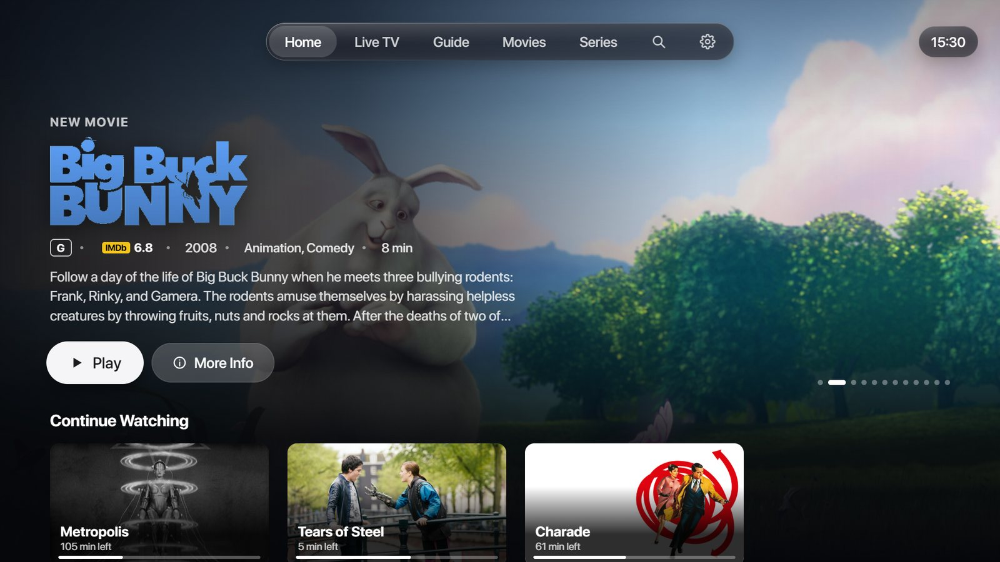

[Sports](#nouveau-dans-la-11--sports) · [Fonctions](#fonctions) · [Captures](#captures-décran) · [Ta TV](#samsung-lg-ou-android) · [Installation](#installation) · [Ajouter ta playlist](#ajouter-ta-playlist) · [APL Launcher](#par-lauteur-dapl-launcher) · [Vie privée](#vie-privée-et-sécurité) · [English](README.md)

</div>

---

> **APL TV est seulement un lecteur.** Il ne contient aucune chaîne, aucune playlist et aucun fournisseur : tu ajoutes les tiens. Utilise-le uniquement avec des contenus que tu as le droit de regarder.

## Nouveau dans la 1.1 : Sports

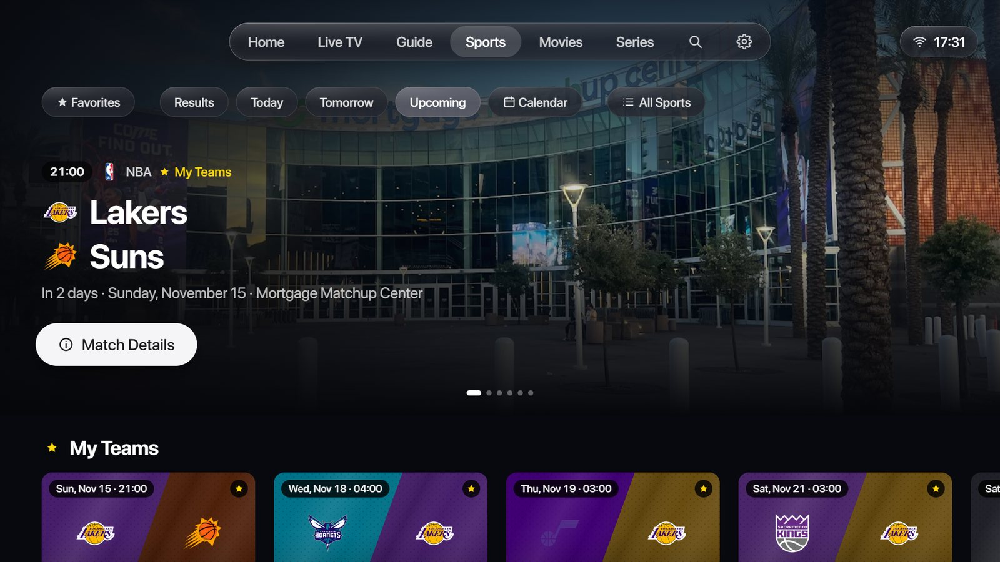

Un onglet entier pour le sport, dans le style d'Apple TV et d'Apple Sports : les scores en direct, tes équipes, et les chaînes de ta propre playlist qui montrent chaque match.

- **Tous les matchs, en direct.** Football, rugby, basket, handball, volley, football américain et hockey sur glace, plus de cent compétitions : la Ligue 1, la Premier League, la Liga, la Serie A, la Bundesliga et la Ligue des champions, le Tournoi des Six Nations et le Top 14, la NBA et l'EuroLeague, la NFL, la NHL et bien d'autres. Les matchs en cours passent en premier, avec le score et la minute, et se mettent à jour tout seuls.
- **Tes équipes.** La première fois, choisis tes sports, tes compétitions, tes clubs et tes sélections (hommes, femmes, matchs amicaux). La bannière du haut montre le match en cours de ton équipe ou son prochain match, avec une photo du stade, et Mes équipes réunit leurs résultats et leurs prochains matchs.
- **Où le regarder.** La page d'un match trouve les chaînes de ta propre playlist qui le montrent, dans le guide TV de ton fournisseur (les deux équipes dans un programme à l'heure du match) ou dans le nom des chaînes événementielles, ta langue d'abord. OK et ça démarre. Les diffuseurs officiels de ton pays sont affichés aussi, des semaines à l'avance.
- **La page d'un match.** Le score et les buteurs, puis Résumé (buts, cartons, changements), Statistiques, Compositions et Classement.
- **Résumés vidéo.** Pour un match terminé, APL TV trouve le résumé officiel sur YouTube (la chaîne de la ligue, du club ou du diffuseur, ta langue d'abord) et le lit directement dans l'app, à la télécommande : OK pour mettre en pause, ◀ ▶ 10 s, Retour pour revenir au match.
- **Résultats, Aujourd'hui, Demain, Prochainement et un calendrier.** N'importe quel jour du mois, avec les logos de tes compétitions sous chaque jour et une étoile quand une de tes équipes joue. Tous les sports ou un seul, dans une liste.
- **Fluide.** Mesuré écran par écran entre 55 et 60 images par seconde sur un Smart Monitor M8 de Samsung et sur Android TV.

| | |
|---|---|
| 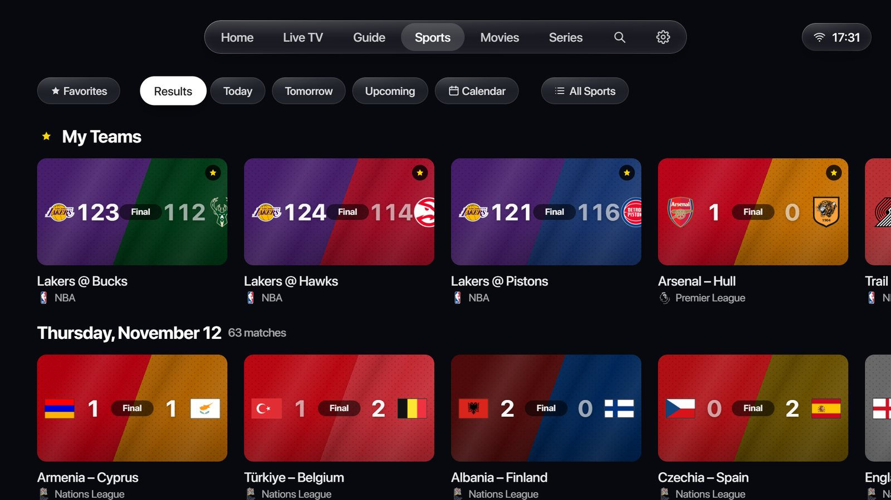 **Résultats :** tes équipes d'abord, puis chaque jour, compétition par compétition. | 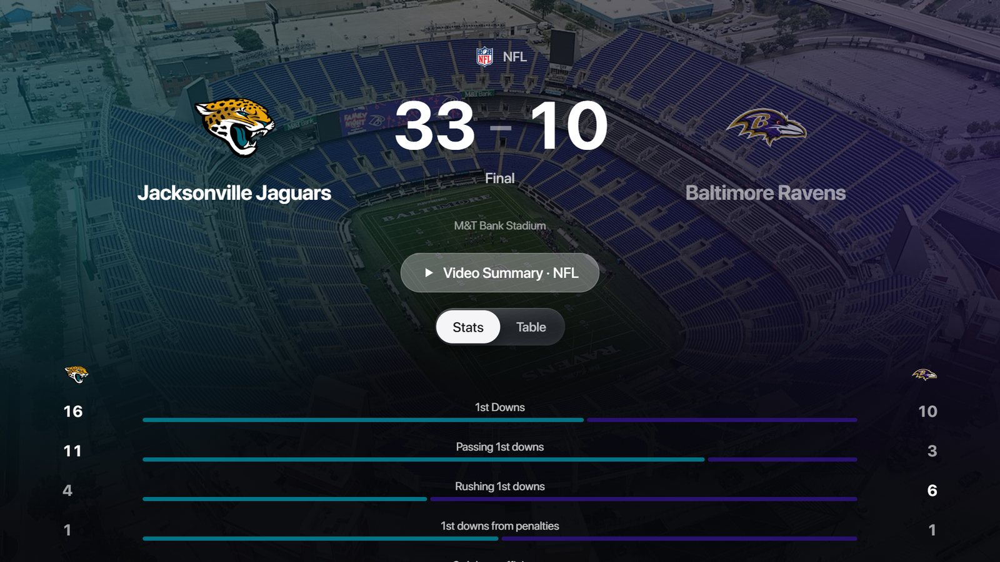 **La page d'un match :** le score, le résumé vidéo, les statistiques, les compositions et le classement. |
| 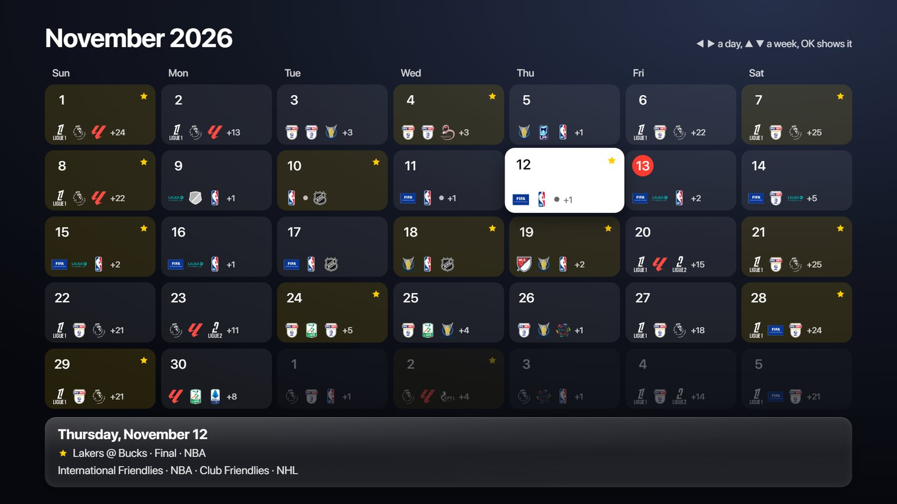 **Calendrier :** tes compétitions jour par jour, une étoile quand ton équipe joue. | 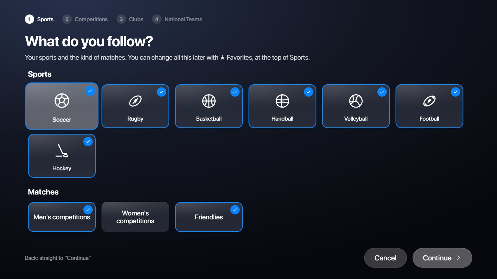 **Favoris :** sports, compétitions, clubs et sélections. |

Aussi nouveau dans la 1.1 : donner tes propres noms aux chaînes, le replay du fournisseur dans le guide TV, les genres dans une seule liste dans Films et Séries, un clavier de recherche arabe, le polonais, et ta progression synchronisée avec Jellyfin et Emby.

## Fonctions

La même app sur chaque TV : même look, mêmes fonctions, mêmes mises à jour.

- **Sports.** Les scores en direct, tes équipes, les chaînes de ta playlist qui montrent chaque match, les résumés vidéo officiels lus dans l'app, les résultats, un calendrier (voir [plus haut](#nouveau-dans-la-11--sports)).
- **Accueil façon Apple TV.** Un grand titre à la une parmi ce que tout le monde regarde cette semaine (image de fond, logo du titre, âge conseillé, note IMDb, résumé), puis Reprendre, À suivre pour tes séries, Chaînes favorites avec ce qui passe, Ma liste, Films et Séries tendance, les nouveautés, Les mieux notés et des rangées par genre (anime, K-drama, studios comme Ghibli ou Pixar, séries Netflix, HBO…).
- **TV en direct.** La chaîne sur laquelle tu es passe en plein écran derrière l'interface, avec son programme, le temps restant et la suite. Catégories (Favoris, Récentes, tes propres groupes, puis celles de ton fournisseur, ta langue d'abord, et toutes dans une liste par pays), touches numériques, chaîne précédente, et les versions 4K / FHD / HD d'une chaîne sur une seule carte. OK maintenu sur une chaîne pour l'ajouter à un de tes groupes, choisir son guide TV ou la **renommer** (ton nom s'affiche partout et reste quand ta playlist se met à jour). **Mets le direct en pause et reviens en arrière** (timeshift) : APL TV garde la chaîne à partir du moment où tu mets en pause, jusqu'à une heure, puis ◀ ▶ reculent ou avancent de 10 s, et ▲ puis OK sur **Revenir au direct** (ou Stop) rattrape le direct.
- **Guide TV** en grille, depuis le guide XMLTV de ton fournisseur (ou le guide court d'Xtream), avec epg.pw et iptv-epg.org pour les chaînes qui n'en ont pas. Un interrupteur le désactive sur une TV lente.
- **Le replay du fournisseur.** Quand ton fournisseur garde les programmes passés d'une chaîne (l'archive Xtream, ou les balises de replay d'une playlist M3U), ils portent une petite marque de replay dans le guide TV : OK en lance un, depuis son début, avec pause et avance. Pendant que tu regardes une telle chaîne, son menu propose Depuis le début.
- **Films et séries.** Nouveautés, Mieux notés, Ma liste, puis les genres (horreur, comédie, anime, studios…) et les catégories de ton fournisseur dans une seule liste, les affiches avec leur note IMDb, et une page par titre : le vrai résumé dans ta langue (TMDB), les saisons et épisodes avec ceux que tu as vus cochés, la saga du film, Titres similaires pris dans ton propre catalogue, le réalisateur et les acteurs, et une page pour chaque acteur. Les versions d'un même titre (langues, 4K) sont regroupées : celle dans ta langue, dans la meilleure qualité que ton écran affiche, est choisie, et celle que tu choisis est retenue. Un bouton Trier (ajoutés récemment, de A à Z, année, note).
- **Le lecteur.** Menus Sous-titres et Audio pendant la lecture (films, séries et chaînes en direct), téléchargement OpenSubtitles avec réglage du décalage (jamais choisi par défaut), style des sous-titres, avance et retour précis (par 10 s, plus vite en restant appuyé), épisode précédent et suivant, une carte « Épisode suivant » avec une image qui ne dévoile rien, une minuterie de mise en veille, le format de l'image (adapter, remplir l'écran, format d'origine). Infos du flux (résolution, codec, débit, images par seconde, son, vitesse de connexion, mémoire tampon, images perdues) et Qualité (les versions 4K / FHD / HD d'une chaîne, ou les qualités d'un flux qui en a plusieurs). Les flux à plusieurs qualités démarrent à la meilleure. Le menu Audio peut faire de la langue que tu entends celle où démarrent les films et séries. Quand un film ou un épisode n'a pas le son dans ta langue mais qu'une autre version l'a (VF, MULTI…), APL TV propose d'y passer, au même moment. Rien ne se lance tout seul, sauf si tu actives la lecture automatique. Sur Android, un décalage du son (AV Sync) de -1000 à +1000 ms. Les sous-titres et pistes audio portent le nom de leur langue dans ta langue.
- **Reprendre là où tu t'es arrêté.** À l'ouverture, APL TV te propose le film ou l'épisode que tu regardais, à la minute où tu t'es arrêté, ou la dernière chaîne.
- **Protection des écrans OLED.** APL TV reconnaît une TV OLED (LG le dit lui-même ; les Samsung, Sony et Philips OLED par leur modèle) et la protège du marquage : l'interface se décale de quelques pixels toutes les 2 minutes, et après 5 minutes sans télécommande quand rien ne joue, un économiseur montre des images de ton catalogue qui défilent lentement, avec l'heure dans un coin qui change toutes les quelques minutes. Réglages › Protection de l'écran (Automatique, Activée, Désactivée).
- **L'âge conseillé selon les règles de ton pays** (France -12 / -16, États-Unis PG-13 / R, Allemagne FSK 16…), converti depuis les pays voisins quand le tien n'en a pas.
- **Masquer ce que tu ne veux pas voir.** Les catégories adultes sont masquées par défaut. Dans les Réglages, tu peux masquer des thèmes entiers (violence, horreur, drogues, gore… 20 thèmes, reconnus grâce aux mots-clés TMDB et aux noms de catégories de ton fournisseur) et des titres un par un : ils disparaissent partout, recherche et tendances comprises. Les pays et les catégories aussi : Réglages > Pays et catégories liste les pays et régions de tes playlists, tu masques tout un pays ou seulement certaines de ses catégories (ou OK maintenu sur une catégorie). Tes chaînes favorites restent.
- **Ta playlist telle quelle, ou rangée.** Au premier démarrage, APL TV demande : ranger les catégories (ta langue d'abord, `EU| FR| Sport` est lu comme français), nettoyer les noms (étiquettes de pays et de qualité comme `FR|` ou `FHD` retirées) et regrouper les versions HD / FHD / 4K d'une chaîne, ou garder ta playlist exactement comme ton fournisseur l'a faite. Réglages › Lecture le change quand tu veux. Les séparateurs sont toujours ignorés.
- **Ton propre serveur multimédia.** Jellyfin et Emby (l'adresse du serveur, ton nom d'utilisateur et ton mot de passe) et Plex (un code que tu tapes sur plex.tv/link) : tes films et séries, une catégorie par bibliothèque, avec les images et résumés du serveur, lus directement depuis lui. Chaque serveur a **son propre onglet** après Séries (Plex, Jellyfin, Emby), comme l'Accueil mais avec ce serveur seulement : ses derniers titres, Reprendre, Ajoutés récemment et une rangée par bibliothèque. Ses bibliothèques sont aussi des catégories dans Films et Séries. Avec Jellyfin et Emby, là où tu t'es arrêté et ce que tu as vu se synchronisent dans les deux sens avec le serveur.
- **Recherche** dans les chaînes, films et séries avec un clavier à l'écran disposé comme celui d'un ordinateur (AZERTY en français, QWERTY sinon, dans l'ordre alphabétique, ou arabe), ou le clavier de la TV elle-même (Gboard sur Android TV). Accents et majuscules ne comptent pas.
- **À la voix avec Alexa.** La petite [skill APL TV](alexa-skill/) amène tes recherches et tes chaînes dans APL TV, sur n'importe quelle TV : « Alexa, demande à APL TV de chercher les films Dragon Ball » et les résultats sont à l'écran ; « Alexa, demande à APL TV de mettre M6 » et la chaîne démarre. Sur Samsung, l'Alexa de l'écran arrive aussi directement dans APL TV pour « Alexa, pause », lecture, avance et épisode suivant.
- **Configuration depuis le téléphone.** La TV affiche un QR code ; ton téléphone ouvre une page servie par la TV elle-même sur ton Wi-Fi (aucun site extérieur), protégée par un code à usage unique. La télécommande marche aussi. Ton téléphone peut aussi **modifier ta playlist** : masquer et ranger tes catégories, faire tes groupes de chaînes, ranger tes favoris et renommer des chaînes, puis tout envoyer à la TV (Réglages › Modifier sur ton téléphone).
- **Mises à jour automatiques.** APL TV regarde ce dépôt toutes les 6 heures et se met à jour tout seul (code, style, textes), puis redémarre quand rien n'est en lecture. Tes playlists et tes réglages restent. Chaque TV ne prend que les mises à jour prêtes pour elle ; quand sa partie installée change, elle demande une fois une nouvelle installation. Réglages › Mises à jour.
- En français, en anglais et en polonais (suit la langue de la TV).

## Captures d'écran

| | |
|---|---|
| 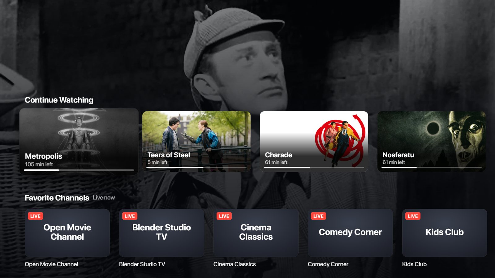 **Accueil :** Reprendre, Chaînes favorites et d'autres rangées sous le titre à la une. | 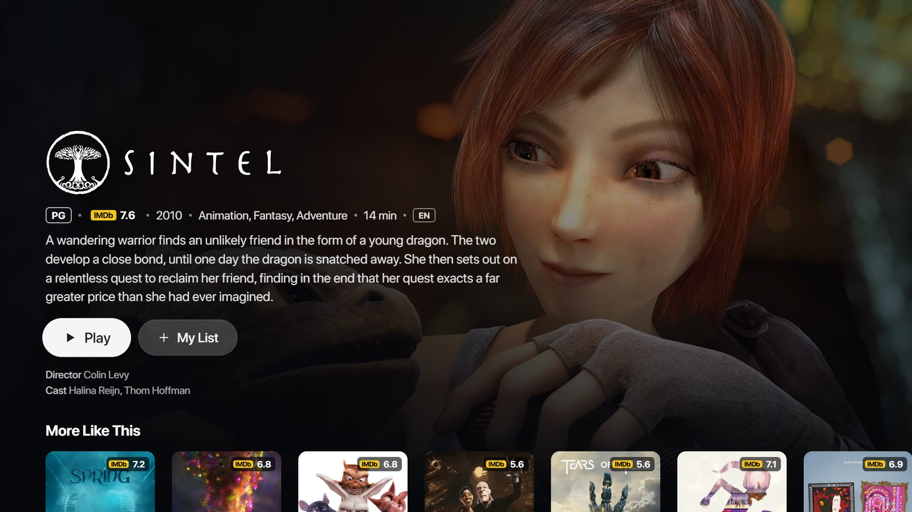 **Fiche d'un titre :** logo, âge conseillé, IMDb, résumé, réalisateur et acteurs, Titres similaires. |
|  **Séries :** saisons, épisodes avec leurs propres images et résumés, les acteurs. | 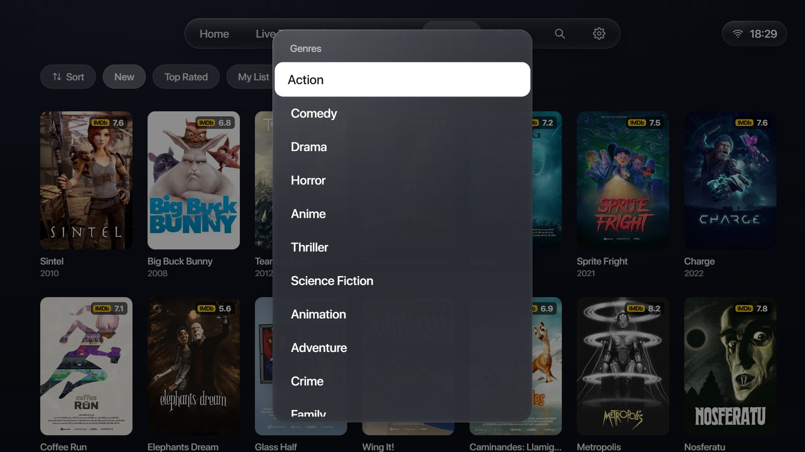 **Films :** les genres et tes catégories dans une seule liste, la note IMDb sur chaque affiche. |
| 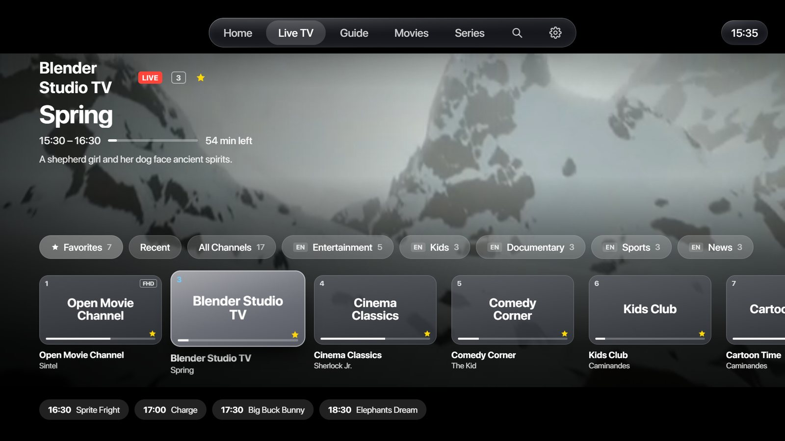 **TV en direct :** la chaîne passe derrière, ce qui passe et la suite. | 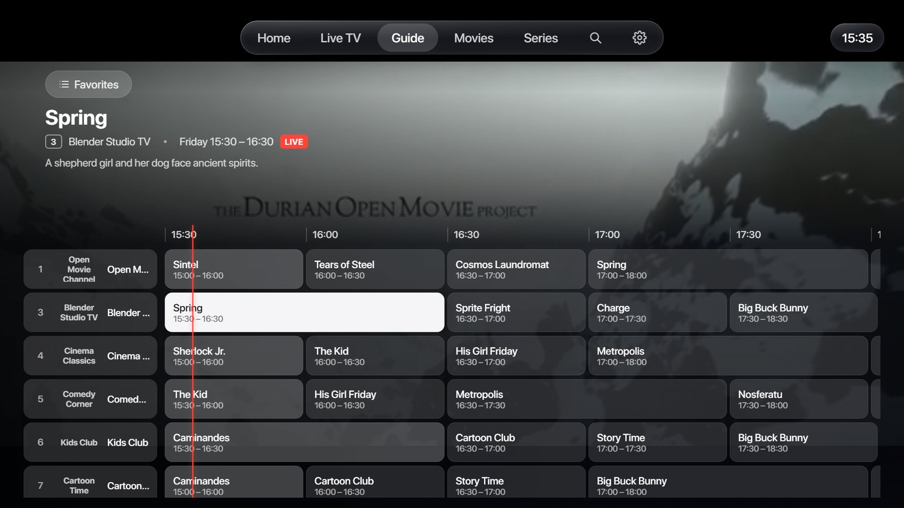 **Guide TV :** une grille des prochaines heures, la chaîne derrière. |
|  **Le lecteur :** barre façon Apple TV, avance précise, heure de fin. | 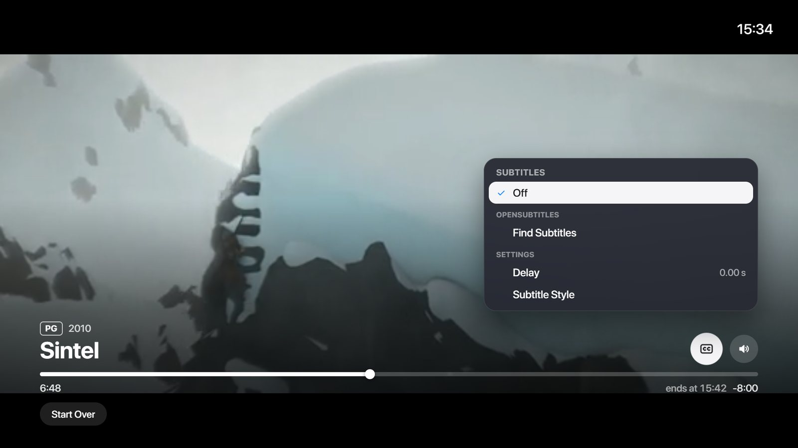 **Sous-titres :** les pistes de la vidéo, OpenSubtitles, décalage et style. |
| 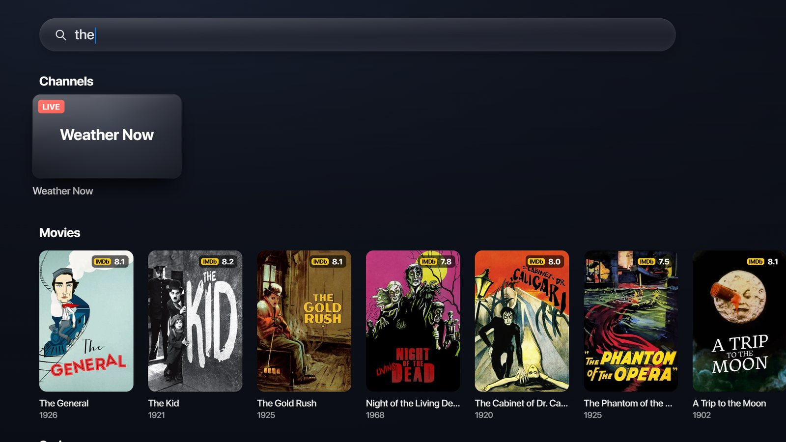 **Recherche :** chaînes, films et séries en même temps, au clavier ou à la voix. | 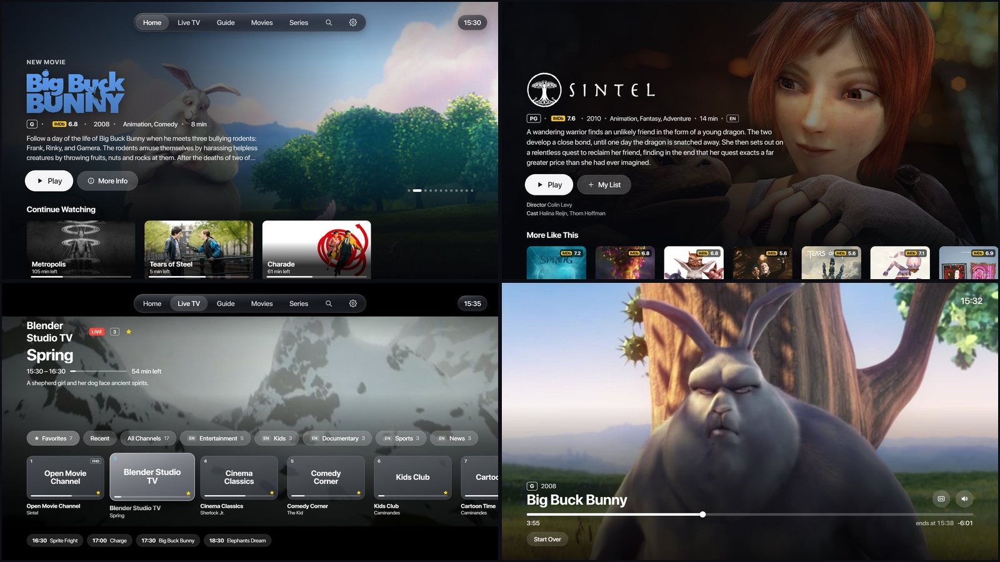 **Tout à la télécommande**, dans le look d'APL Launcher. |

Les captures n'utilisent que du contenu de démonstration : des films libres de la Blender Foundation (CC BY) et des classiques du domaine public, avec des noms de chaînes inventés. APL TV lui-même ne contient rien à regarder.

## Samsung, LG ou Android

| | Samsung (Tizen 6 ou plus récent) | LG (webOS) | Android TV, Google TV, Fire TV |
|---|---|---|---|
| Paquet | `apl-tv-vX.Y.Z.wgt` | `apl-tv-vX.Y.Z-lg-webos.ipk` | `apl-tv-vX.Y.Z-android.apk` |
| Root nécessaire | Non | Non | Non |
| Lecteur vidéo | AVPlay de Samsung | Le lecteur de LG | ExoPlayer |
| Voix | L'Alexa de l'écran + la skill APL TV | La skill APL TV | La skill APL TV |
| Multiview (plusieurs chaînes) | Oui | Pas encore | Non |
| Top Shelf d'APL Launcher | Oui | Non (APL Launcher est pour Samsung) | Non |
| Télécommande | Toutes les touches | Toutes les touches ; le pointeur de la Magic Remote n'est pas encore utilisé | Toutes les touches |
| Sous-titres intégrés à la vidéo | Oui | Oui, affichés par la TV | Oui |
| Pause du direct (timeshift) | Oui | Oui | Oui |
| Replay du fournisseur | Oui | Oui | Oui |
| Sports, résumés vidéo dans l'app | Oui | Oui | Oui |
| Décalage du son (AV Sync) | Les réglages de son de la TV | Les réglages de son de la TV | Oui, dans APL TV |
| Plex, Jellyfin, Emby | Oui | Oui | Oui |
| Testé sur | Smart Monitor M8 (Tizen 9) | OLED G5 (webOS 25) | Android TV 14 (émulateur) |

Dis-nous dans une [issue](../../issues/new/choose) comment ça tourne sur la tienne : le formulaire demande ta TV, et chaque issue et pull request reçoit l'étiquette de sa TV. Issues pour [Samsung](../../issues?q=is%3Aissue+label%3Asamsung), [LG](../../issues?q=is%3Aissue+label%3Alg-webos), [Android TV](../../issues?q=is%3Aissue+label%3Aandroid-tv) ; pull requests pour [Samsung](../../pulls?q=is%3Apr+label%3Asamsung), [LG](../../pulls?q=is%3Apr+label%3Alg-webos), [Android TV](../../pulls?q=is%3Apr+label%3Aandroid-tv).

Facultatif sur chaque TV, mais conseillé : une [clé API TMDB](https://www.themoviedb.org/settings/api) gratuite pour les affiches, résumés, acteurs, âges conseillés, tendances et Titres similaires. Sans elle, APL TV lit tout quand même, avec les affiches de ton fournisseur. Tape-la dans APL TV › Réglages › Clé TMDB.

## Installation

Télécharge le paquet de ta TV dans les [Releases](../../releases/latest). Chacun a son SHA256 (`SHA256SUMS-*.txt`).

### Samsung (Tizen)

**Pas de root.** APL TV est une app ordinaire : elle s'installe en mode développeur. Un écran du commerce n'installe que les apps signées pour lui : il te faut un certificat Samsung pour ton écran (Certificate Manager de Tizen Studio, ou Apps2Samsung).

- **Avec APL Launcher Setup (conseillé).** Dans [APL Launcher Setup](https://github.com/Knikt/APL-Launcher-for-TizenOS/releases/latest), page Installation, active **Installer aussi APL TV**. Setup télécharge la dernière version ici, vérifie son SHA256, ajoute ta clé TMDB et les polices et sons d'APL Launcher, la signe avec ton certificat et l'installe sur l'écran (par Vetro s'il est là, sinon en mode développeur). Relancer l'installation met APL TV à jour et garde tes playlists. Depuis le dossier d'APL Launcher, APL TV seul : `.\scripts\06-install-apltv.ps1 -TvIp 192.168.1.50 -ProfileName <ton profil de signature>`
- **Avec Apps2Samsung.** APL TV est dans son catalogue.
- **À la main, en mode développeur.** Active le mode développeur sur l'écran (Apps, puis 1 2 3 4 5 sur la télécommande, Host PC IP = l'adresse de ce PC), puis signe à nouveau `apl-tv-vX.Y.Z.wgt` pour ton écran et installe-le, par exemple avec la ligne de commande de Tizen Studio :

```powershell
tizen package -t wgt -s <ton profil de signature> -- apl-tv-vX.Y.Z.wgt
sdb connect <adresse de l'écran>
tizen install -n apl-tv-vX.Y.Z.wgt -t <ton écran>
```

### LG (webOS)

**Pas de root.** APL TV s'installe comme toute app faite pour les TV LG, en mode développeur :

1. Sur la TV, installe **Developer Mode** depuis le LG Content Store et connecte-toi avec un [compte développeur LG](https://webostv.developer.lge.com) gratuit. Active **Dev Mode Status**, puis **Key Server**.
2. Sur ton PC, installe les outils webOS de LG ([Node.js](https://nodejs.org) nécessaire) : `npm install -g @webos-tools/cli`, ou utilise l'app communautaire [webOS Dev Manager](https://github.com/webosbrew/dev-manager-desktop) à la place des commandes ci-dessous.
3. Ajoute la TV et récupère sa clé (la phrase secrète est affichée dans l'app Developer Mode), puis installe :

```powershell
ares-setup-device --add tv -i "host=<adresse de la TV>" -i "port=9922" -i "username=prisoner"
ares-novacom --device tv --getkey
ares-install --device tv apl-tv-vX.Y.Z-lg-webos.ipk
```

Le mode développeur de LG dure un nombre d'heures limité : appuie de temps en temps sur **Extend Session Time** dans l'app Developer Mode, sinon LG désactive les apps que tu as installées (tes playlists restent). Chaque version contient aussi `apl-tv.manifest.json`, le manifeste qu'utilise le Homebrew Channel de webOS.

### Android TV, Google TV et Fire TV

**Pas de root.** Installe le `.apk` comme toute app venant d'ailleurs que le store :

- **Sur la TV, avec l'app Downloader :** tape le code **9141513**. Il donne toujours la dernière version (`https://github.com/Knikt/APL-TV/releases/latest/download/apl-tv-android.apk`). Android demande une fois d'autoriser les apps venant de Downloader.
- **Depuis un PC :** active les options pour les développeurs de la TV, puis `adb connect <adresse de la TV>` et `adb install apl-tv-vX.Y.Z-android.apk`.

Un `.apk` plus récent s'installe par-dessus l'ancien et garde tes playlists. Tous les `.apk` d'APL TV sont signés avec la même clé.

### Depuis le code source

Copie `app/js/keys.example.js` en `app/js/keys.local.js` et mets-y ta clé TMDB, puis fabrique pour ta TV :

```powershell
.\tools\build.ps1 -TizenCli <chemin de tizen.bat> -Profile <ton profil de signature> -Install -Ip 192.168.1.50 -Launch   # Samsung
python tools/make-webos.py      # LG : dist/com.knikt.apltv_X.Y.Z_all.ipk (outils webOS de LG)
python tools/make-android.py    # Android : dist/apl-tv-vX.Y.Z-personal.apk (JDK 17+, SDK Android 35, Gradle 8.10)
```

`tools/check.py` lance les mêmes vérifications que GitHub Actions. `--dev` (et `-Dev` pour Samsung) ajoute un journal de développement servi par l'assistant sur le port 8765, jamais pour l'usage de tous les jours.

Organisation : `app/` est l'app elle-même, la même sur chaque TV (app web ES5) ; `app/js/core.js` reconnaît la TV. `app/service/service.js` est son assistant (la page téléphone, les guides TV compressés, les notes IMDb, les fournisseurs sans CORS) : un service web Tizen sur Samsung, un service JS webOS sur LG (`webos/`), et `Helper.java` dans l'app Android (`android/`), où ExoPlayer lit la vidéo sous la page (`app/js/android.js`). Les fichiers personnels ne sont jamais dans le dépôt : `app/js/keys.local.js`, les polices SF Pro, les sons de l'interface et les clés de signature.

## Ajouter ta playlist

APL TV › Réglages › Playlists › Ajouter une playlist › **Depuis le téléphone** : scanne le QR code avec ton téléphone (sur le même Wi-Fi que la TV), tape ou colle ton lien M3U, ton serveur Xtream, ton identifiant et ton mot de passe, ton portail Stalker et ton adresse MAC, ou ton serveur Jellyfin ou Emby, et appuie sur Envoyer à l'écran. Pour Plex, choisis **Ton serveur multimédia** › Plex : un code s'affiche sur la TV, tape-le sur plex.tv/link. Tu peux ajouter plusieurs playlists. Un lien M3U qui est en réalité un lien Xtream (`get.php?username=…`) est lu comme Xtream, avec les affiches, les résumés et le guide TV.

## Par l'auteur d'APL Launcher

APL TV est fait par Knikt (Gero Corp.), qui fait aussi **[APL Launcher for Tizen OS](https://github.com/Knikt/APL-Launcher-for-TizenOS)** : un écran d'accueil façon Apple TV pour les TV et Smart Monitors Samsung sous Tizen, avec un Top Shelf vivant pour chaque app, un dock en verre, un Centre de contrôle par-dessus n'importe quelle app, des Réglages et Sources façon Apple TV, des profils pour la famille avec Memoji, et Alexa sur le bouton micro de la télécommande. Son installateur Windows, APL Launcher Setup, met tout sur l'écran en quelques minutes.

Sur Samsung, les deux sont faits pour aller ensemble :

- APL TV a le look du launcher, ses sons d'interface et ses polices.
- Sur l'écran d'accueil du launcher, le Top Shelf d'APL TV montre le film ou l'épisode que tu regardais, à sa minute, et ta dernière chaîne. OK l'ouvre directement.
- APL Launcher Setup installe APL TV d'un seul interrupteur, avec ta clé TMDB, et le garde à jour.

Si APL TV te plaît, jette un œil à APL Launcher, et une étoile sur l'un ou l'autre dépôt fait toujours plaisir.

## Questions

**Quelles playlists marchent ?** Les liens M3U, les comptes Xtream, les portails Stalker (MAG / Ministra : l'adresse du portail et une adresse MAC) et ton propre serveur multimédia : Jellyfin, Emby ou Plex. Ajoutes-en autant que tu veux : quand il y en a plusieurs, chaque catégorie affiche le nom de sa playlist.

**Erreur 403 ou 404 au chargement d'une playlist ?** Le fournisseur a refusé la demande (certains cachent un refus derrière un 404, « introuvable »). Certains fournisseurs n'acceptent que les lecteurs qu'ils connaissent (VLC, IPTV Smarters…) : APL TV redemande alors tout seul sous ces noms et retient celui qui marche, pour la playlist, le guide et les vidéos (sur LG, les vidéos gardent le nom de la TV). Si tout est refusé, c'est le compte lui-même : expiré ou suspendu, déjà utilisé sur un autre écran, ou un VPN ou un pays bloqué par le fournisseur. Le message montre ce que le serveur a écrit. Un 404 qui reste après ces essais veut dire que l'adresse elle-même est fausse : pour un compte Xtream, donne seulement le serveur et son port.

**Je peux faire mes propres groupes de chaînes ?** Oui : OK maintenu sur une chaîne › Ajouter à un groupe › Nouveau groupe. Tes groupes arrivent juste après les Favoris dans la TV en direct et le Guide. OK maintenu sur un groupe pour le renommer ou le supprimer, et sur une de ses chaînes pour la monter ou la descendre.

**Et les préfixes et suffixes dans les noms des chaînes ?** Ils sont retirés tout seuls : étiquettes de pays (`FR|`, `UK:`), mentions de qualité (FHD, 4K, HEVC…) et décorations, et les versions 4K / FHD / HD d'une chaîne sont regroupées sur une seule carte.

**Je peux choisir le guide TV ?** Pour chaque playlist, mets ta propre adresse XMLTV dans ses réglages (en plus du guide de ton fournisseur et des guides publics associés automatiquement). Pour une chaîne, OK maintenu dessus › Guide TV de cette chaîne : cherche dans le guide de ton fournisseur par son nom, ou prends les programmes d'une autre chaîne (la version HD d'une chaîne 4K, par exemple).

**Plex, Jellyfin ou Emby ?** Réglages › Ajouter une playlist › Ton serveur multimédia (ou le bouton de l'écran d'accueil). Jellyfin et Emby : l'adresse de ton serveur (le port 8096 est essayé si tu n'en mets pas), ton nom d'utilisateur et ton mot de passe ; depuis ton téléphone aussi. Plex : un code s'affiche sur la TV, tape-le sur plex.tv/link ; si ton compte a plusieurs serveurs, tu choisis. Les fichiers sont lus tels quels (sans transcodage), la TV doit donc savoir les décoder.

**D'où viennent les scores de Sports ?** Des tableaux de scores publics d'ESPN (sans compte, sans clé), de 365Scores pour ce qu'ESPN n'a pas, de la LFP pour les chaînes de Ligue 1 et de Ligue 2, les photos de stades de Wikipédia (licences libres), et les résumés vidéo des chaînes YouTube officielles. APL TV les affiche ; il ne diffuse rien lui-même.

**Un match ne montre pas mes chaînes ?** APL TV cherche les deux équipes dans le guide TV de ton fournisseur à l'heure du match, et dans le nom des chaînes événementielles. Quand le guide ne les nomme pas, la page du match montre les diffuseurs officiels et un bouton pour les chercher dans tes chaînes.

**Je peux renommer une chaîne ?** Oui : OK maintenu dessus › Renommer, ou Réglages › Modifier sur ton téléphone › Noms. Ton nom s'affiche partout (TV en direct, guide, recherche, Reprendre, Dernière chaîne d'APL Launcher) et reste quand ta playlist se met à jour ; la recherche trouve toujours la chaîne par son ancien nom. Redonne-lui son ancien nom, ou choisis Nom du fournisseur dans son menu, pour revenir en arrière.

**Le replay des programmes passés ?** Si ton fournisseur les garde, oui : les programmes passés avec une petite marque de replay dans le guide TV se lancent avec OK (OK maintenu pour le menu), et le menu d'une chaîne propose Depuis le début. Quelles chaînes l'ont, et sur combien de jours, dépend de ton fournisseur : les comptes Xtream le disent pour chaque chaîne, les playlists M3U avec des balises de replay (catchup, catchup-days, catchup-source, tvg-rec ou timeshift).

**Je peux mettre le direct en pause ?** Oui : Lecture/Pause sur une chaîne, ou le premier bouton de la barre. APL TV garde la chaîne à partir de ce moment, jusqu'à une heure (400 Mo sur Samsung et LG, 800 Mo sur Android), avec une seule connexion, donc ça marche avec les abonnements à un seul écran. ◀ ▶ reculent ou avancent de 10 s, ▲ puis OK sur Revenir au direct rattrape le direct. Réglages › Lecture › Pause du direct le désactive. Chaînes MPEG-TS seulement (les chaînes Xtream en HLS sont lues en MPEG-TS pour ça).

**Modifier ma playlist sur mon téléphone ?** Réglages › Playlists › Modifier sur ton téléphone, scanne le QR code : masque ou affiche des catégories et fais-les glisser par leur poignée (la page défile toute seule), ou touches-en plusieurs et envoie-les tout en haut, tout en bas ou après une autre d'un coup, avec une recherche pour les trouver dans une longue liste ; fais et remplis tes groupes de chaînes, range tes favoris, puis Envoyer à la TV. Envoie autant de fois que tu veux.

**Je peux garder ma playlist exactement comme mon fournisseur l'a faite ?** Oui : réponds « Garder ma playlist telle quelle » au premier démarrage, ou désactive les trois choix dans Réglages › Lecture.

**Quelque chose demande la nouvelle installation ?** Les portails Stalker, la pause du direct, la modification au téléphone, la dernière page téléphone (avec l'onglet Noms) et les résumés vidéo lus dans APL TV passent par le service d'APL TV sur la TV, qui ne change qu'avec une nouvelle installation (en attendant, les résumés vidéo s'ouvrent dans l'app YouTube) : relance une fois APL Launcher Setup (Samsung) ou installe une fois le dernier `.ipk` (LG). Sur Android, installe une fois le dernier `.apk`. Tout le reste se met à jour tout seul.

**Installer vite sur Fire TV ou Android TV ?** Dans l'app Downloader, tape le code **9141513**.

## Vie privée et sécurité

- Tes playlists et tes comptes restent sur la TV, dans le stockage d'APL TV. Ils ne sont envoyés qu'à ton fournisseur, et jamais écrits dans les journaux.
- APL TV ne parle qu'à ton fournisseur, à TMDB et Cinemeta de Stremio (pour reconnaître les titres), aux fichiers publics d'IMDb (le fichier des notes, une fois par jour), aux sources de guides TV, à OpenSubtitles par le module public de Stremio (seulement quand tu cherches des sous-titres), à ton propre serveur Jellyfin, Emby ou Plex (et plex.tv pour relier Plex) si tu en ajoutes un, pour Sports aux tableaux de scores publics d'ESPN, à 365Scores, à la LFP et à Wikipédia, et à YouTube (pour trouver les résumés vidéo officiels, et son lecteur intégré depuis youtube-nocookie.com quand tu en regardes un), à GitHub toutes les 6 heures pour chercher une mise à jour (Réglages › Mises à jour le désactive), et, seulement si tu actives la skill Alexa, à ton sujet ntfy.sh privé (les mots cherchés seulement).
- L'assistant sur la TV (port 8765) ne répond qu'à APL TV lui-même, et aux pages téléphone pendant que leur code est affiché. Une chaîne mise en pause est gardée dans la mémoire temporaire de la TV et effacée quand tu reviens au direct. Les sites ouverts dans le navigateur de la TV sont refusés. Le code est aléatoire, change à chaque fois, et trop de mauvais codes le ferment.
- Pas de compte, pas de statistiques, pas de pub.

## Soutenir APL TV

APL TV est gratuit, open source et fait par une seule personne sur son temps libre. Si tu l'aimes et que tu veux m'aider, tu peux m'offrir un café sur [Ko-fi](https://ko-fi.com/knikt). Ce n'est jamais obligatoire et tout reste gratuit. La même page soutient aussi [APL Launcher](https://github.com/Knikt/APL-Launcher-for-TizenOS).

Dans APL TV, Réglages › Soutenir APL TV affiche un QR code pour ouvrir la page sur ton téléphone.

[](https://ko-fi.com/knikt)

## Crédits

APL TV est fait par **Knikt** (Gero Corp.)

- Données et images des films et séries : [TMDB](https://www.themoviedb.org). Ce produit utilise l'API TMDB mais n'est ni approuvé ni certifié par TMDB.
- Notes IMDb par Cinemeta de Stremio et les [fichiers d'IMDb](https://developer.imdb.com/non-commercial-datasets/) (usage personnel et non commercial) ; sous-titres d'[OpenSubtitles](https://www.opensubtitles.org) par le module OpenSubtitles de Stremio.
- Guides TV : le XMLTV de ton fournisseur, [epg.pw](https://epg.pw) et [iptv-epg.org](https://iptv-epg.org).
- Sports : scores, photos de matchs et diffuseurs par ESPN, les autres sports par 365Scores, les chaînes de Ligue 1 et de Ligue 2 par la LFP, photos de stades de Wikipédia (Wikimedia Commons, licences libres), résumés vidéo sur YouTube depuis les chaînes officielles.
- Sur Android, la vidéo est lue par [AndroidX Media3 / ExoPlayer](https://github.com/androidx/media) (licence Apache 2.0).
- Le look, les sons et les polices viennent d'APL Launcher.

APL TV n'est affilié ni à Apple, ni à Samsung, LG, Google, Amazon, TMDB, IMDb, OpenSubtitles, Stremio, ESPN, 365Scores, la LFP, YouTube, ni à aucune ligue, aucun club ou aucun fournisseur IPTV. Les noms et logos appartiennent à leurs propriétaires.

## Licence

[MIT](LICENSE). Les polices SF Pro et les sons de l'interface ne font pas partie de ce dépôt : APL Launcher Setup copie ceux que tu as.
