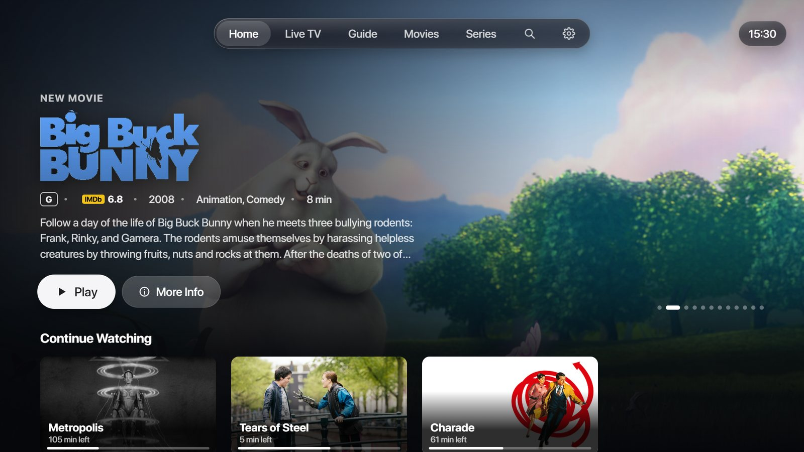
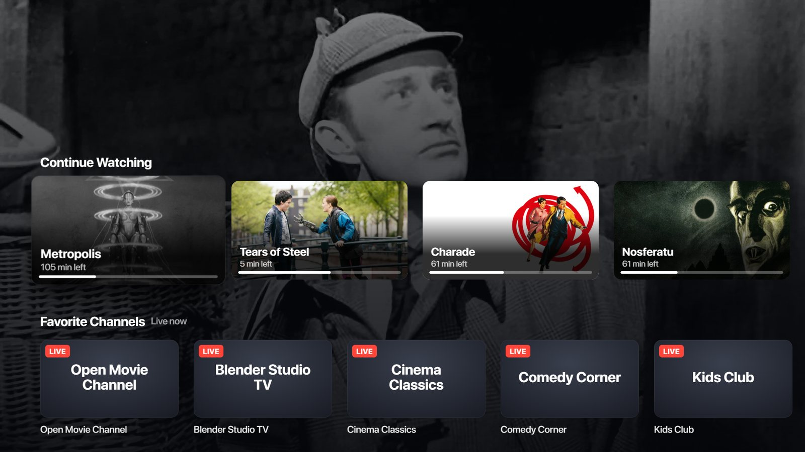
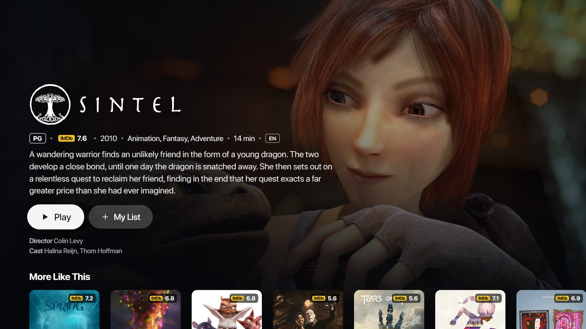
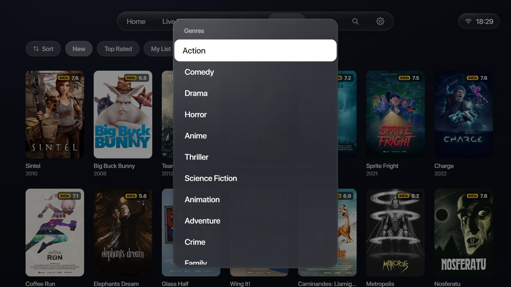
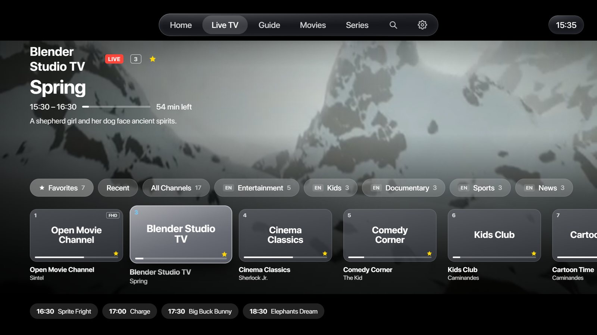
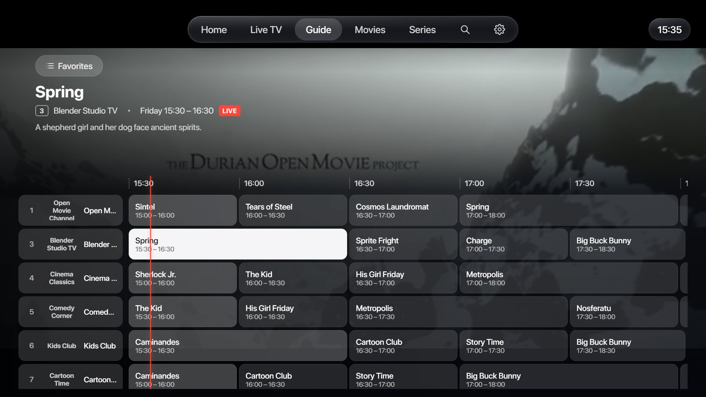
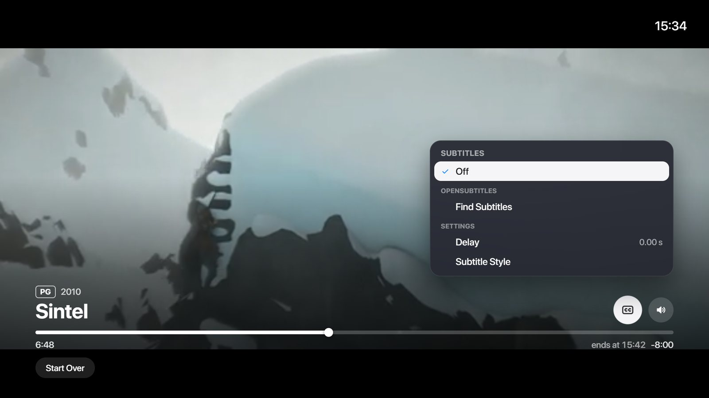
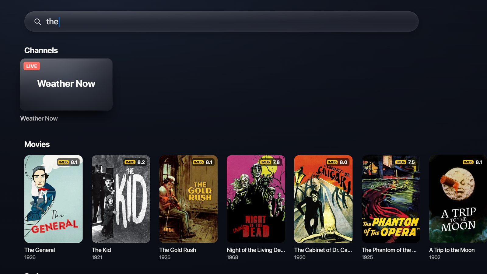
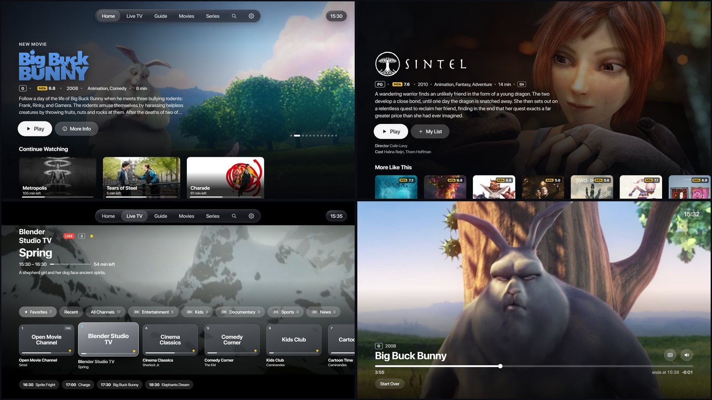

<div align="center">

# APL TV

**An Apple TV style IPTV player for Samsung, LG and Android TV.**
Live TV, movies and series from your own M3U playlists and Xtream accounts, in the style of [APL Launcher](https://github.com/Knikt/APL-Launcher-for-TizenOS): tvOS look, Liquid Glass, focus animations and sounds, everything with the remote.

**Samsung** (Tizen TVs and Smart Monitors) · **LG** (webOS TVs) · **Android TV**, Google TV and Fire TV

Created by **Knikt** (Gero Corp.), the maker of [APL Launcher](https://github.com/Knikt/APL-Launcher-for-TizenOS)



[Features](#features) · [Screenshots](#screenshots) · [Your TV](#samsung-lg-or-android) · [Install](#install) · [Add your playlist](#add-your-playlist) · [APL Launcher](#from-the-maker-of-apl-launcher) · [Privacy](#privacy-and-security) · [Français](README.fr.md)

</div>

---

> **APL TV is only a player.** It comes with no channels, no playlists and no provider: you add your own. Only use it with content you have the right to watch.

## Features

The same app on every TV: same look, same features, same updates.

- **Home, Apple TV style.** A large featured title from what everyone watches this week (backdrop, title logo, age rating, IMDb rating, plot), then Continue Watching, Up Next for your series, Favorite Channels with what's on now, My List, Trending Movies and Series, new releases, Top Rated and genre rows (anime, K-drama, studios like Ghibli or Pixar, series from Netflix, HBO…).
- **Live TV.** The channel you are on plays full screen behind the interface, with its programme, time left and what comes next. Categories (Favorites, Recent, your own groups, then your provider's, your language first, and all of them in a list by country), number keys, previous channel, and the 4K / FHD / HD versions of one channel on one card. Hold OK on a channel to add it to a group of your own or to choose its TV guide. **Pause a live channel and go back in it** (timeshift): APL TV keeps the channel from the moment you pause, up to an hour, then ◀ ▶ move 10 s back or forward, and ▲ then OK on **Back to Live** (or Stop) catches up.
- **Your own media server.** Jellyfin and Emby (the server's address, your user name and password) and Plex (a code you type on plex.tv/link): your movies and series, one category per library, with the server's pictures and plots, played straight from the server. Each server gets **its own tab** after Series (Plex, Jellyfin, Emby), like Home with only that server: its newest titles, Continue Watching, Recently Added and a row per library. Its libraries are also categories in Movies and Series.
- **TV guide** as a grid, from your provider's XMLTV guide (or Xtream's short guide), with epg.pw and iptv-epg.org for channels without one.
- **Movies and series.** Your provider's categories, covers with their IMDb rating, and a page for each title: the real plot in your language (TMDB), seasons and episodes with the ones you watched ticked, the movie's saga, More Like This from your own catalog, the director and the cast, and a page for each actor. Versions of one title (languages, 4K) are grouped together: the one in your language in the best quality your screen shows is picked, and the one you choose is remembered. A Sort button (recently added, A to Z, year, rating).
- **The player.** Subtitles and Audio menus during playback (movies, series and live channels), OpenSubtitles download with a delay adjustment (never chosen by default), subtitle style, precise seeking (10 s steps, faster when you hold), previous and next episode, a next episode card with a picture that spoils nothing, a sleep timer, Picture Size (fit, fill the screen, original shape), Stream Info (resolution, codec, bitrate, frame rate, sound, connection speed, buffer, dropped frames) and Quality (the 4K / FHD / HD versions of a channel, or the qualities of a stream that has several). Streams with several qualities start at the best one. The Audio menu can make the language you are hearing the one movies and series start in. When a movie or an episode has no sound in your language but another version of it does (VF, MULTI…), APL TV offers to switch to it, at the same moment. Nothing plays by itself unless you turn Autoplay on.
- **Pick up where you left off.** When APL TV opens, it offers the movie or episode you were watching at the minute you stopped, or the last channel.
- **Screen protection for OLED screens.** APL TV knows when it runs on an OLED TV (LG says so itself; Samsung, Sony and Philips OLED sets by their model) and protects it from burn-in: the interface moves a few pixels every 2 minutes, and after 5 minutes without the remote while nothing plays, a screen saver shows pictures from your catalog, slowly moving, with the time in a corner that changes every few minutes. Settings › Screen Protection (Automatic, On, Off).
- **Age ratings in your country's own scale** (France -12 / -16, United States PG-13 / R, Germany FSK 16…), converted from nearby countries when yours has none.
- **Hide what you don't want to see.** Adult categories are hidden by default. In Settings you can hide whole themes (violence, horror, drugs, gore… 20 of them, matched with TMDB's tags and your provider's category names) and single titles: they disappear everywhere, search and Trending included. Countries and categories too: Settings > Countries and Categories lists the countries and regions of your playlists, hide a whole one or only some of its categories (or hold OK on a category). Your favorite channels stay.
- **Your playlist as it is, or tidied.** At the first start APL TV asks: sort the categories (your language first, `EU| FR| Sport` is read as French), tidy the names (country and quality tags like `FR|` or `FHD` taken out) and group the HD / FHD / 4K versions of a channel, or keep your playlist exactly as your provider made it. Settings › Playback changes it any time. Separators are always skipped.
- **Search** across channels, movies and series with an on-screen keyboard laid out like a computer's (AZERTY in French, QWERTY otherwise, or in alphabetical order), or the TV's own keyboard (Gboard on Android TV). Accents and case don't matter.
- **Voice with Alexa.** The small [APL TV skill](alexa-skill/) brings your searches and channels to APL TV on any TV: "Alexa, ask APL TV to search Dragon Ball movies" and the results are on screen; "Alexa, ask APL TV to put on M6" and the channel starts. On Samsung, the screen's own Alexa also reaches APL TV directly for "Alexa, pause", play, skip and next episode.
- **Set up from your phone.** The TV shows a QR code; your phone opens a page served by the TV itself on your Wi-Fi (no outside website), protected by a one-time code. The remote works too. Your phone can also **edit your playlist**: hide and order your categories, make your groups of channels and order your favorites, then send it all to the TV (Settings › Edit on Your Phone).
- **Automatic updates.** APL TV checks this repository every 6 hours and updates itself (code, look, texts), then restarts when nothing is playing. Your playlists and settings stay. Each TV only takes the updates that are ready for it; when its installed part changes, it asks once for a new install. Settings › Updates.
- English and French (it follows the TV's language).

## Screenshots

| | |
|---|---|
|  **Home:** Continue Watching, Favorite Channels and more rows under the featured title. |  **A title's page:** logo, age rating, IMDb, plot, director and cast, More Like This. |
|  **Series:** seasons, episodes with their own pictures and plots, the cast. |  **Movies:** your categories and smart genres, IMDb ratings on every cover. |
|  **Live TV:** the channel plays behind, what's on now and next. |  **TV guide:** a grid of the next hours, the channel behind. |
|  **The player:** Apple TV style bar, precise seeking, ends at. |  **Subtitles:** the video's tracks, OpenSubtitles, delay and style. |
|  **Search:** channels, movies and series at once, by keyboard or by voice. |  **Everything with the remote**, in the look of APL Launcher. |

The screenshots use demo content only: open movies from the Blender Foundation (CC BY) and public domain classics, with made-up channel names. APL TV itself comes with nothing to watch.

## Samsung, LG or Android

| | Samsung (Tizen 6 or newer) | LG (webOS) | Android TV, Google TV, Fire TV |
|---|---|---|---|
| Package | `apl-tv-vX.Y.Z.wgt` | `apl-tv-vX.Y.Z-lg-webos.ipk` | `apl-tv-vX.Y.Z-android.apk` |
| Root needed | No | No | No |
| Video player | Samsung's AVPlay | LG's own media player | ExoPlayer |
| Voice | The screen's Alexa + the APL TV skill | The APL TV skill | The APL TV skill |
| Multiview (several channels) | Yes | Not yet | No |
| APL Launcher's Top Shelf | Yes | No (APL Launcher is for Samsung) | No |
| Remote | Every key | Every key; the Magic Remote's pointer is not used yet | Every key |
| Subtitles inside the video | Yes | Yes, drawn by the TV | Yes |
| Pause live TV (timeshift) | Yes | Yes | Yes |
| Plex, Jellyfin, Emby | Yes | Yes | Yes |
| Tested on | Smart Monitor M8 (Tizen 9) | OLED G5 (webOS 25) | Android TV 14 (emulator) |

Tell us in an [issue](../../issues/new/choose) how it runs on yours: the form asks for your TV, and each issue and pull request gets the label of its TV. Issues for [Samsung](../../issues?q=is%3Aissue+label%3Asamsung), [LG](../../issues?q=is%3Aissue+label%3Alg-webos), [Android TV](../../issues?q=is%3Aissue+label%3Aandroid-tv); pull requests for [Samsung](../../pulls?q=is%3Apr+label%3Asamsung), [LG](../../pulls?q=is%3Apr+label%3Alg-webos), [Android TV](../../pulls?q=is%3Apr+label%3Aandroid-tv).

Optional on every TV, but recommended: a free [TMDB API key](https://www.themoviedb.org/settings/api) for posters, plots, cast, age ratings, Trending and More Like This. Without one APL TV still plays everything, with your provider's covers. Type it in APL TV › Settings › TMDB Key.

## Install

Download the package for your TV from [Releases](../../releases/latest). Each one comes with its SHA256 (`SHA256SUMS-*.txt`).

### Samsung (Tizen)

**No root.** APL TV is an ordinary app: it installs in the screen's Developer Mode. A retail screen only installs apps signed for it, so you need a Samsung certificate for your screen (Tizen Studio's Certificate Manager, or Apps2Samsung).

- **With APL Launcher Setup (recommended).** In [APL Launcher Setup](https://github.com/Knikt/APL-Launcher-for-TizenOS/releases/latest), page Install, turn on **Also install APL TV**. Setup downloads the latest release from here, checks its SHA256, adds your TMDB key and APL Launcher's fonts and sounds, signs it with your certificate and installs it on the screen (through Vetro when it is there, otherwise in Developer Mode). Running the installation again updates APL TV and keeps your playlists. From the APL Launcher folder, APL TV alone: `.\scripts\06-install-apltv.ps1 -TvIp 192.168.1.50 -ProfileName <your signing profile>`
- **With Apps2Samsung.** APL TV is in its catalog.
- **By hand, in Developer Mode.** Turn on Developer Mode on the screen (Apps, then 1 2 3 4 5 on the remote, Host PC IP = this PC's address), then sign `apl-tv-vX.Y.Z.wgt` again for your screen and install it, for example with Tizen Studio's CLI:

```powershell
tizen package -t wgt -s <your signing profile> -- apl-tv-vX.Y.Z.wgt
sdb connect <screen address>
tizen install -n apl-tv-vX.Y.Z.wgt -t <your screen>
```

### LG (webOS)

**No root.** APL TV installs like any app made for LG TVs, in Developer Mode:

1. On the TV, install **Developer Mode** from the LG Content Store and sign in with a free [LG developer account](https://webostv.developer.lge.com). Turn on **Dev Mode Status**, then **Key Server**.
2. On your PC, install LG's webOS CLI ([Node.js](https://nodejs.org) needed): `npm install -g @webos-tools/cli`, or use the community app [webOS Dev Manager](https://github.com/webosbrew/dev-manager-desktop) instead of the commands below.
3. Add the TV and get its key (the passphrase is shown in the Developer Mode app), then install:

```powershell
ares-setup-device --add tv -i "host=<TV address>" -i "port=9922" -i "username=prisoner"
ares-novacom --device tv --getkey
ares-install --device tv apl-tv-vX.Y.Z-lg-webos.ipk
```

LG's Developer Mode lasts a set number of hours: press **Extend Session Time** in the Developer Mode app from time to time, otherwise LG turns off the apps you installed (your playlists stay). Each release also has `apl-tv.manifest.json`, the manifest the webOS Homebrew Channel uses.

### Android TV, Google TV and Fire TV

**No root.** Install the `.apk` like any app from outside the store:

- **On the TV, with the Downloader app:** type the code **9141513**. It always gives the latest version (`https://github.com/Knikt/APL-TV/releases/latest/download/apl-tv-android.apk`). Android asks once to allow apps from Downloader.
- **From a PC:** turn on the TV's developer options, then `adb connect <TV address>` and `adb install apl-tv-vX.Y.Z-android.apk`.

A newer `.apk` installs over the old one and keeps your playlists. Every `.apk` of APL TV is signed with the same key.

### From the source

Copy `app/js/keys.example.js` to `app/js/keys.local.js` and put your TMDB key in it, then build for your TV:

```powershell
.\tools\build.ps1 -TizenCli <path to tizen.bat> -Profile <your signing profile> -Install -Ip 192.168.1.50 -Launch   # Samsung
python tools/make-webos.py      # LG: dist/com.knikt.apltv_X.Y.Z_all.ipk (LG's webOS CLI)
python tools/make-android.py    # Android: dist/apl-tv-vX.Y.Z-personal.apk (JDK 17+, Android SDK 35, Gradle 8.10)
```

`tools/check.py` runs the same checks as GitHub Actions. `--dev` (and `-Dev` for Samsung) adds a development log served by the helper on port 8765, never for daily use.

Layout: `app/` is the app itself, the same on every TV (ES5 web app); `app/js/core.js` tells the TVs apart. `app/service/service.js` is its helper (the phone page, compressed TV guides, IMDb ratings, providers without CORS): a Tizen web service on Samsung, a webOS JS service on LG (`webos/`), and `Helper.java` in the Android app (`android/`), where ExoPlayer plays under the page (`app/js/android.js`). Personal files are never in the repository: `app/js/keys.local.js`, the SF Pro fonts, the interface sounds and the signing keys.

## Add your playlist

APL TV › Settings › Playlists › Add a Playlist › **From Your Phone**: scan the QR code with your phone (on the same Wi-Fi as the TV), type or paste your M3U link, your Xtream server, username and password, your Stalker portal and MAC address, or your Jellyfin or Emby server, and tap Send to the screen. For Plex, choose **Your Media Server** › Plex: a code appears on the TV, type it on plex.tv/link. Several playlists can be added. An M3U link that is really an Xtream one (`get.php?username=…`) is read as Xtream, with covers, plots and the TV guide.

## From the maker of APL Launcher

APL TV is made by Knikt (Gero Corp.), who also makes **[APL Launcher for Tizen OS](https://github.com/Knikt/APL-Launcher-for-TizenOS)**: an Apple TV style home screen for Samsung Tizen TVs and Smart Monitors, with a live Top Shelf for every app, a glass dock, a Control Center over any app, Apple TV style Settings and Sources, household profiles with Memoji, and Alexa on the remote's microphone button. Its Windows installer, APL Launcher Setup, puts everything on the screen in a few minutes.

On Samsung, the two are made to go together:

- APL TV has the launcher's look, its interface sounds and its fonts.
- On the launcher's Home Screen, APL TV's Top Shelf shows the movie or episode you were watching at its minute, and your last channel. OK opens it right there.
- APL Launcher Setup installs APL TV with one switch, with your TMDB key, and keeps it up to date.

If you like APL TV, have a look at APL Launcher, and a star on either repository is always appreciated.

## Questions

**Which playlists work?** M3U links, Xtream logins, Stalker portals (MAG / Ministra: the portal's address and a MAC address) and your own media server: Jellyfin, Emby or Plex. Add as many as you want: when there are several, each category shows its playlist's name.

**Error 403 when loading a playlist?** The provider refused the request. Some providers only let in players they know (VLC, IPTV Smarters…): APL TV then asks again under those names by itself and remembers the one that works, for the playlist, the guide and the streams (on LG, the streams keep the TV's own name). If every way is refused, the account itself is the cause: expired or suspended, already in use on another screen, or a VPN or a country the provider blocks. The message shows what the server wrote.

**Can I make my own groups of channels?** Yes: hold OK on a channel › Add to a Group › New Group. Your groups come right after Favorites in Live TV and the Guide. Hold OK on a group to rename or delete it, and on one of its channels to move it up or down.

**What about prefixes and suffixes in channel names?** They're removed automatically: country tags (`FR|`, `UK:`), quality tags (FHD, 4K, HEVC…) and decorations, and the 4K / FHD / HD versions of a channel are grouped on one card.

**Can I choose the TV guide?** For each playlist, put your own XMLTV address in its settings (on top of your provider's guide and the public guides matched automatically). For one channel, hold OK on it › TV Guide for This Channel: search your provider's guide by name, or take the programmes of another channel (the HD version of a 4K channel, for example).

**Plex, Jellyfin or Emby?** Settings › Add a Playlist › Your Media Server (or the button on the welcome screen). Jellyfin and Emby: your server's address (port 8096 is tried when you give none), your user name and password; from your phone too. Plex: a code appears on the TV, type it on plex.tv/link; if your account has several servers, you choose one. Files play as they are (no transcoding), so the TV must be able to decode them.

**Can I pause live TV?** Yes: Play/Pause on a channel, or the first button of the bar. APL TV keeps the channel from that moment, up to an hour (400 MB on Samsung and LG, 800 MB on Android), and only one connection is used, so it works with one-screen subscriptions. ◀ ▶ move 10 s, ▲ then OK on Back to Live catches up. Settings › Playback › Pause Live TV turns it off. MPEG-TS channels only (Xtream channels in HLS are read as MPEG-TS for it).

**Edit my playlist on my phone?** Settings › Playlists › Edit on Your Phone, scan the QR code: hide or show categories and drag them by their handle (the page scrolls by itself), or tap several and send them to the top, to the bottom or after another one in one go, with a search to find them in a long list; make and fill your groups of channels, order your favorites, then Send to the TV. Send as many times as you like.

**Can I keep my playlist exactly as my provider made it?** Yes: answer "Keep My Playlist As It Is" at the first start, or turn off the three choices in Settings › Playback.

**Something asks for the new install?** Stalker portals, pausing live TV, editing on the phone and the newest phone page use APL TV's helper on the TV, which only changes with a new install: run APL Launcher Setup again (Samsung) or install the latest `.ipk` (LG) once. On Android, install the latest `.apk` once. Everything else updates by itself.

**Install on Fire TV or Android TV quickly?** In the Downloader app, type the code **9141513**.

## Privacy and security

- Your playlists and accounts stay on the TV, in APL TV's own storage. They are only sent to your provider, and never written in logs.
- APL TV only talks to your provider, to TMDB and Stremio's Cinemeta (to look titles up), to IMDb's public datasets (the ratings file, once a day), to the guide sources, to OpenSubtitles through Stremio's public add-on (only when you look for subtitles), to your own Jellyfin, Emby or Plex server (and plex.tv to link Plex) if you add one, to GitHub every 6 hours to look for an update (Settings › Updates turns it off), and, only if you turn on the Alexa skill, to your private ntfy.sh topic (the searched words only).
- The helper on the TV (port 8765) only answers APL TV itself, and the phone pages while their code is shown. A channel you pause is kept in the TV's temporary memory and deleted when you go back to live. Websites opened in the TV's browser are refused. The code is random, changes each time, and too many wrong codes close it.
- No account, no analytics, no ads.

## Support APL TV

APL TV is free, open source and made by one person in my spare time. If you like it and want to help, you can buy me a coffee on [Ko-fi](https://ko-fi.com/knikt). It's never required and everything stays free. The same page supports [APL Launcher](https://github.com/Knikt/APL-Launcher-for-TizenOS) too.

In APL TV, Settings › Support APL TV shows a QR code to open the page on your phone.

[](https://ko-fi.com/knikt)

## Credits

APL TV is made by **Knikt** (Gero Corp.)

- Film and series data and pictures: [TMDB](https://www.themoviedb.org). This product uses the TMDB API but is not endorsed or certified by TMDB.
- IMDb ratings through Stremio's Cinemeta and [IMDb's datasets](https://developer.imdb.com/non-commercial-datasets/) (personal and non-commercial use); subtitles from [OpenSubtitles](https://www.opensubtitles.org) through Stremio's OpenSubtitles add-on.
- TV guides: your provider's XMLTV, [epg.pw](https://epg.pw) and [iptv-epg.org](https://iptv-epg.org).
- On Android, video is played by [AndroidX Media3 / ExoPlayer](https://github.com/androidx/media) (Apache License 2.0).
- The look, the sounds and the fonts come from APL Launcher.

APL TV is not affiliated with Apple, Samsung, LG, Google, Amazon, TMDB, IMDb, OpenSubtitles, Stremio or any IPTV provider. Names and logos belong to their owners.

## License

[MIT](LICENSE). The SF Pro fonts and the interface sounds are not part of this repository: APL Launcher Setup copies the ones you have.
